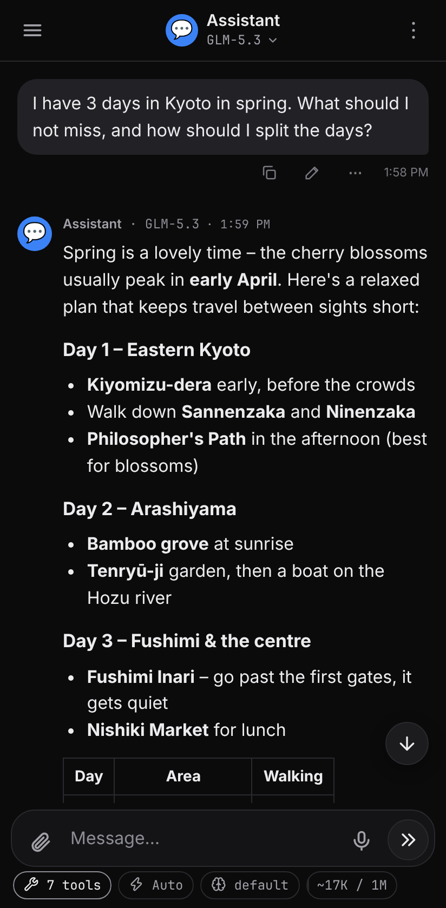
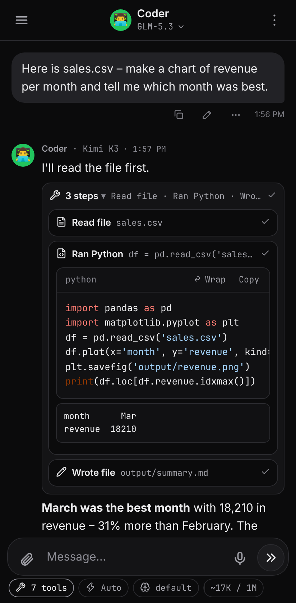
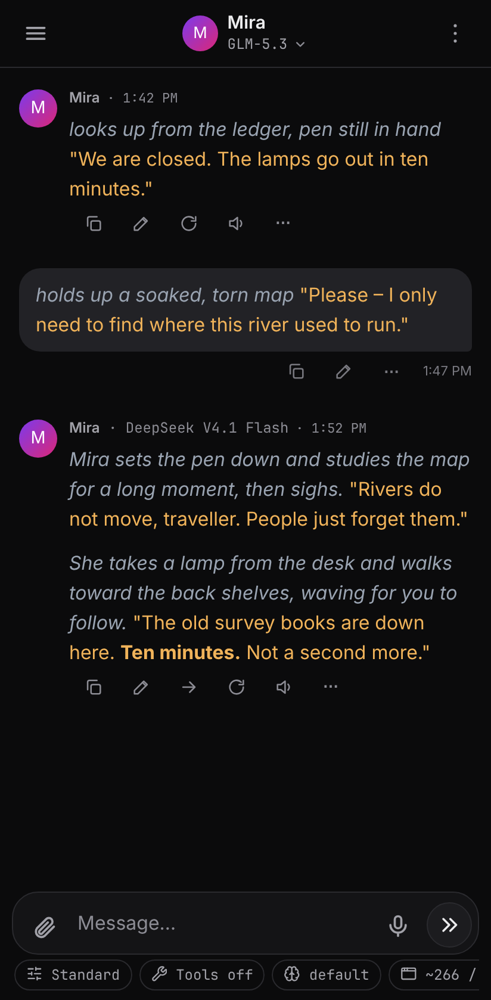
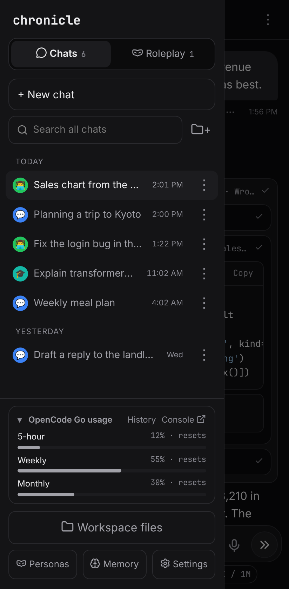
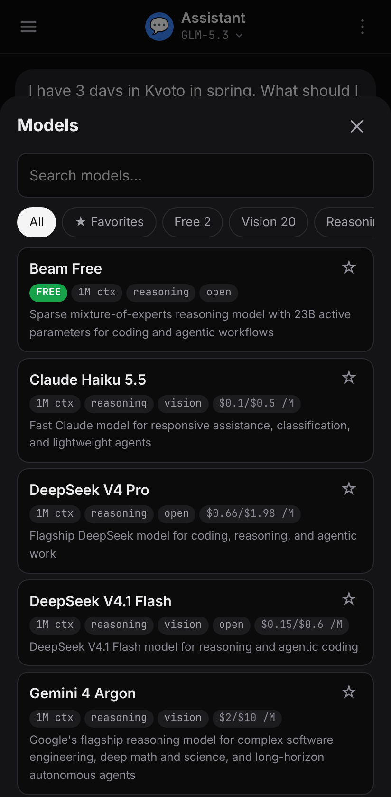
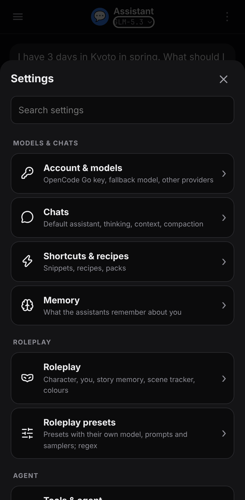

# Chronicle

Chronicle is an Android app for chatting with AI models, roleplaying with characters, and running an AI agent on your phone: it can search the web, read and write files, run Python and Linux commands, use MCP servers and drive a browser.

It is a personal, unofficial project. It is not affiliated with Anthropic, OpenCode or any model provider.

## Built with Claude

Almost all of this code was written by **Claude** (Anthropic's AI model), working through **Claude Code**, with a person deciding what to build, testing it on a real phone and reporting what broke. The design notes in [`docs/DECISIONS.md`](docs/DECISIONS.md) are the record of that work. Expect the strengths and weaknesses that come with it: a lot was built quickly and is covered by automated tests, but not every feature has been tried on every phone.

The app can also *use* Claude:

- **With an Anthropic API key**, Claude models run inside Chronicle's own agent, billed to that key.
- **With Claude Code**, installed in the app's built-in Linux and signed in with your own Claude account, Chronicle can hand coding work to it. Chronicle never reads or copies Claude Code's sign-in.

You don't need Claude at all: any OpenAI-compatible provider works, and the app started out around [OpenCode Go](https://opencode.ai).

## What it does

**Chat.** Any model from OpenCode Go/Zen, OpenRouter, DeepSeek, Anthropic, a local server or another OpenAI-compatible endpoint. Streaming replies, Markdown, code boxes, math and diagrams. Swipes and branches, editing, automatic summaries for long chats, a usage and cost view. Personas with their own prompt, picture, model and tools.

**Roleplay.** Character cards (PNG/JSON/CHARX, V1–V3) and lorebooks, with SillyTavern-style prompt building: author's notes, world info at depth, chat variables, group chats, story memory and impersonation.

**Agent.** Tools you switch on per chat or per persona:

- web search and page reading
- a per-chat workspace with file tools
- a Python sandbox, and a full Linux (Debian, via proot) with a shell and background jobs
- MCP servers, including sign-in and a registry browser
- a browser it drives like Playwright, which hands the page to you for sign-ins
- files on your computer: folders you share with a small script (`scripts/pc-files.py`), read-only unless you allow saving
- the phone's calendar, contacts, places and notifications, each asking first
- helper agents on cheaper models
- plan mode, hooks, `AGENTS.md`/`CLAUDE.md` project instructions, undo and rewind

**Your data.** Everything stays on your phone. API keys are kept in the Android Keystore. Backup and restore make one zip, and "Export everything" also carries keys, git histories and the Linux home folder, so you can move to another phone.

The full feature list is in [`docs/FEATURES.md`](docs/FEATURES.md).

## Screenshots

| Chat | Agent with tools | Roleplay |
| --- | --- | --- |
|  |  |  |

| Chat list | Models | Settings |
| --- | --- | --- |
|  |  |  |

The pictures are made from the app itself with made-up chats (`SCREENSHOTS=1 npx playwright test tests/e2e/screenshots.spec.js`).

## Install

1. Open the [latest release](https://github.com/amon28/chronicle-harness/releases/tag/latest) on your Android phone and tap **chronicle.apk**.
2. Allow installing from your browser when Android asks, then **Install**.
3. Open Chronicle, add an API key in **Settings › Account & models**, pick a model and start a chat.

Updates install over the old version and keep your chats, as long as every build is signed with the same key (see below).

### "Blocked by Play Protect" / "this app may steal your data"

On some phones Android refuses to install Chronicle, or warns that it could steal data. This is Google Play Protect's **enhanced fraud protection**, which is on by default in several countries (among them the Philippines, India, Brazil, Thailand, Singapore and Malaysia). It blocks any app installed from outside the Play Store – a browser, a file manager, a chat app – that *declares* one of these permissions:

- reading or receiving SMS (Chronicle asks for **read SMS**, for the optional "read my texts" tool)
- reading notifications (Chronicle has a **notification listener**, for the optional "read my notifications" tool)
- accessibility services

The check only looks at the list of permissions in the app, not at what the app does with them. Chronicle keeps your data on your phone and these two tools only work after you switch them on and Android asks you, but Play Protect cannot know that. It's the same block any app with these permissions gets.

What you can do:

- **Install it anyway:** open the Play Store › your profile › Play Protect › ⚙ and turn off "Scan apps with Play Protect" for the install, then turn it back on. Or install from a computer with `adb install chronicle.apk` (not covered by this check).
- **Build it without those permissions** if you don't need texts or notifications: remove `READ_SMS` and the `NotifyListener` service from `android/app/src/main/AndroidManifest.xml` and build it yourself (see below). The rest of the app works the same.

Google is also bringing in **developer verification** (from September 2026 in Brazil, Indonesia, Singapore and Thailand, worldwide in 2027): apps on certified phones must come from a verified developer, or be installed through an extra "advanced" step. Read Google's [developer verification guide](https://support.google.com/android-developer-console/answer/16561738) and the [announcement](https://android-developers.googleblog.com/2026/03/android-developer-verification.html) for what that means for installing apps from GitHub.

## Build it yourself

```bash
npm install
npm run dev            # the web version at http://localhost:5173
npm run android:apk    # Android build → android/app/build/outputs/apk/release/
```

The Android build needs JDK 21 and the Android SDK. [`docs/DEV.md`](docs/DEV.md) has the setup and a fast build-and-install loop.

### Signing (so updates install over each other)

```bash
keytool -genkeypair -keystore release.keystore -alias chronicle -keyalg RSA -keysize 2048 -validity 10000 -dname "CN=Chronicle"
base64 -w0 release.keystore
```

In the repo's **Settings › Secrets and variables › Actions**, add:
- `OCM_KEYSTORE_BASE64`: the base64 text from the second command
- `OCM_KEYSTORE_PASSWORD`
- `OCM_KEY_ALIAS`: only if your key's alias isn't `chronicle`

Keep `release.keystore` out of git. Without these secrets, CI signs with a throwaway key and every update needs an uninstall first.

### Web version (optional)

Browsers block direct calls to some providers (no CORS). Deploy [`proxy/worker.js`](proxy/worker.js) as a Cloudflare Worker, host the app with the *Deploy PWA to GitHub Pages* workflow, and paste the worker's URL in the app's Settings.

## Tests

```bash
npm run lint
npm test               # unit tests (Vitest)
npm run test:e2e       # end-to-end (Playwright) against a mock model server
```

CI runs all three on every push. Things only a real phone can check (background work, notifications, the Keystore, voice, Linux) are on the manual checklist in [`docs/DEVICE-TESTS.md`](docs/DEVICE-TESTS.md).

## Docs

- [`docs/FEATURES.md`](docs/FEATURES.md): everything the app does
- [`docs/ARCHITECTURE.md`](docs/ARCHITECTURE.md): how the pieces fit, and where things are in the code
- [`docs/DECISIONS.md`](docs/DECISIONS.md): why things are the way they are
- [`docs/HARNESS.md`](docs/HARNESS.md): how the agent's tools behave (also given to the agent)
- [`docs/MODS.md`](docs/MODS.md): writing mods (small JavaScript add-ons)
- [`docs/HANDOFF.md`](docs/HANDOFF.md): working on the code

## Licence

No licence has been chosen yet, so all rights are reserved for now.
